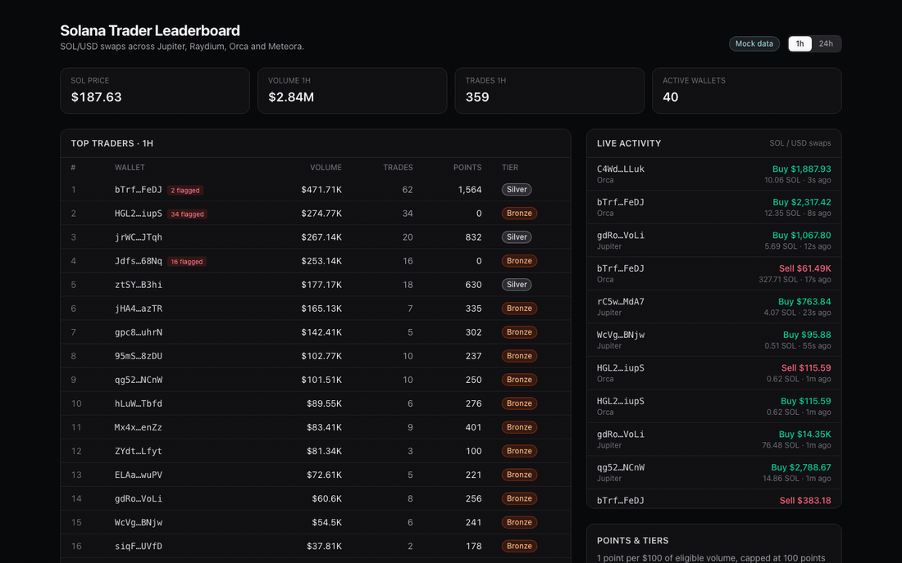
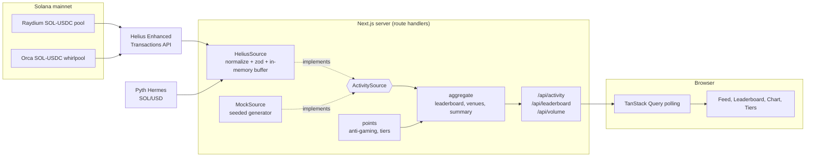

# Solana Trader Leaderboard

A small, real-time trader dashboard on top of Solana onchain swap data. It shows a live feed of SOL/USD swaps, a
leaderboard of the most active wallets, volume per venue, and a points / VIP-tier system with basic anti-gaming rules.

It runs fully offline on deterministic mock data, and switches to live mainnet data when a Helius API key is set.



<sub>Mock mode, about one minute of live updates. [Full-page screenshot](docs/screenshot.png) including the volume chart.</sub>

## Features

- **Live activity feed**: latest swaps (short wallet, venue, side, USD size, time), polled every 3s.
- **Trader leaderboard**: top wallets by USD volume over **1h / 24h**, with rank, volume, trade count, points and tier.
- **Volume by venue**: Jupiter / Raydium / Orca / Meteora bar chart for the selected window.
- **Points & tiers**: a pure scoring function turns volume into points and Bronze / Silver / Gold tiers, with wash
  trading excluded and flagged in the UI.

## Architecture



### How data flows from chain to UI

1. **Fetch.** `HeliusSource` pulls the latest `SWAP` transactions touching a set of well-known SOL/USDC pools from the
   Helius Enhanced Transactions API. Aggregator flow (Jupiter) is captured because routes settle through those pools.
2. **Normalize.** Each raw transaction is validated with zod and turned into a single `Swap` type
   (`src/lib/sources/types.ts`): wallet, venue, side relative to SOL, SOL amount and USD value. USD comes from the
   stablecoin leg when there is one, otherwise SOL amount × Pyth SOL/USD. Failed, malformed or non-SOL transactions
   are dropped, never thrown.
3. **Buffer.** Swaps are merged into an in-memory map keyed by signature (dedupe), pruned after 24h. Refreshes are
   throttled to one every 5s, and concurrent requests share a single in-flight fetch.
4. **Aggregate.** Route handlers slice the window (1h / 24h) and call pure functions in `src/lib/aggregate` and
   `src/lib/points`.
5. **Render.** The client polls the three endpoints with TanStack Query (3s for the feed, 10s for aggregates) and keeps
   the previous data on screen while a new window loads.

Everything downstream of `ActivitySource` only knows the `Swap` type, so swapping the data layer (RPC, Geyser, a
database) doesn't touch aggregation, scoring or UI.

## Points, tiers and anti-gaming

All rules live in `src/lib/points/index.ts` as pure functions with defaults in `DEFAULT_RULES`.

| Rule                 | Default                    | Why                                                          |
| -------------------- | -------------------------- | ------------------------------------------------------------ |
| Points rate          | 1 point per $100 of volume | Simple and explainable                                       |
| Dust filter          | Trades under $10 earn 0    | Stops farming with thousands of tiny swaps                   |
| Per-trade cap        | Max 100 points per trade   | One huge trade can't buy a tier; rewards consistent activity |
| Wash / self-trade    | Excluded                   | See below                                                    |
| Duplicate signatures | Counted once               | Idempotent under retries / overlapping fetches               |

**Wash detection.** For each wallet, swaps are walked in time order. A buy and a sell within **5 minutes** whose USD
sizes are within **2%** of each other form a round trip, and both legs are excluded from points. Each swap can be
matched at most once. Excluded trades still count toward raw volume on the leaderboard, so a wash trader can rank high
on volume while sitting in Bronze with a visible "N flagged" marker.

**Tiers.** Bronze from 0 points, Silver from 500, Gold from 2,500, computed over the selected window.

The mock generator includes two wallets that wash-trade on purpose, and a test asserts the scorer catches all of their
trades.

## Running it

Requires Node 20+.

```bash
npm install
cp .env.example .env.local   # optional
npm run dev                  # http://localhost:3000
```

### Mock mode (default)

With no `HELIUS_API_KEY`, the app uses `MockSource`: time is split into 15s slots and each slot's swaps are generated
from a seeded PRNG. The feed advances in real time, but any given window always produces the same data, which makes the
tests and CI reproducible and fully offline. `DATA_MODE=mock` forces mock mode even when a key is present.

### Live mode

1. Get a free API key at [helius.dev](https://dashboard.helius.dev).
2. Set `HELIUS_API_KEY` in `.env.local`.
3. Optionally set `SOLANA_POOL_ADDRESSES` (comma-separated) to watch other pools.

The header badge switches from **Mock data** to **Live · Helius**. The SOL price comes from Pyth Hermes (no key).

### Scripts

| Command             | What it does            |
| ------------------- | ----------------------- |
| `npm run dev`       | Dev server              |
| `npm run lint`      | ESLint                  |
| `npm run typecheck` | `tsc --noEmit` (strict) |
| `npm test`          | Vitest, offline         |
| `npm run coverage`  | Vitest with v8 coverage |
| `npm run build`     | Production build        |
| `npm run format`    | Prettier                |

CI (GitHub Actions) runs install, lint, format check, typecheck, tests and build on every push and PR, always in mock
mode.

## Project structure

```
src/
  app/                    Next.js App Router: page, layout, providers, API route handlers
  components/             Dashboard, feed, leaderboard, chart, tier badge (+ smoke test)
  lib/
    sources/              Swap type + zod schema, ActivitySource, HeliusSource, MockSource, Pyth price
    aggregate/            Leaderboard, volume by venue, summary (pure)
    points/               Points, tiers and anti-gaming rules (pure)
    queries.ts            TanStack Query hooks
```

## Trade-offs

- **Polling, not streaming.** HTTP polling is simple, cache-friendly and good enough at a 3s cadence. SSE or WebSockets
  would cut latency and wasted requests.
- **In-memory buffer.** Live history only exists while the server process runs, and each process has its own. On
  serverless, windows will be thin. That's acceptable for a demo, not for production.
- **Pool-based sampling.** Watching a few pools captures most SOL/USDC flow, not all of it, and each poll only sees the
  latest page of transactions per pool. During bursts some swaps can be missed.
- **Heuristic wash detection.** Same-wallet round trips are easy to catch. Coordinated wash trading across wallets
  needs funding-graph analysis. The 2% / 5 min rule can also flag legitimate scalpers (visible in the mock data), which
  is why flagged trades are shown, not hidden.
- **Fee payer as trader.** The wallet is the transaction fee payer, which is wrong for relayed or bot-sponsored
  transactions.

## What I'd do next

1. **Real indexer.** Ingest via a Geyser gRPC stream (e.g. Yellowstone) or Helius webhooks instead of polling, decode
   swaps directly from program instructions for every major AMM, and backfill history.
2. **Persistent store.** Write normalized swaps to Postgres/ClickHouse (or Timescale) with rollups per wallet and venue,
   so windows survive restarts and scale to 7d / 30d.
3. **Push to clients.** WebSockets or SSE fan-out from the indexer, with the client merging deltas into the TanStack
   Query cache.
4. **Smarter anti-gaming.** Cross-wallet clustering via funding sources, minimum hold times, and per-epoch point
   budgets.
5. **Wallet pages.** Per-trader history, PnL and tier progress.

## License

MIT
